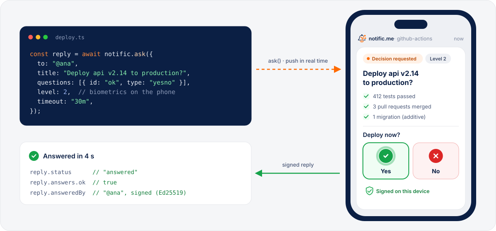
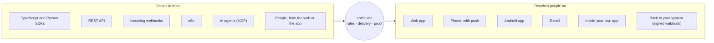
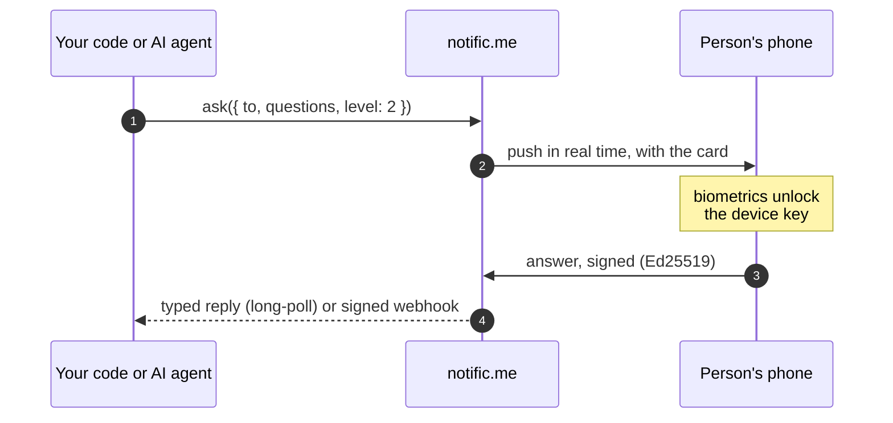
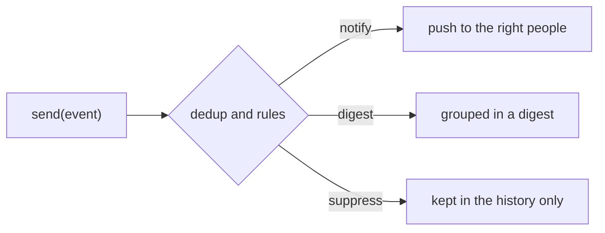

<p align="center">
  <a href="https://notific.me">
    <picture>
      <source media="(prefers-color-scheme: dark)" srcset=".github/assets/lockup-on-dark.svg">
      
    </picture>
  </a>
</p>

<p align="center">
  <a href="https://www.npmjs.com/package/@notificme/sdk"></a>
  <a href="https://pypi.org/project/notificme/"></a>
  <a href="https://github.com/idIe-ai/notificme-sdk/actions/workflows/ci.yml"></a>
  <a href="LICENSE"></a>
  <a href="https://docs.notific.me"></a>
</p>

<br>

<p align="center">
  <picture>
    <source media="(prefers-color-scheme: dark)" srcset=".github/assets/hero-dark.svg">
    
  </picture>
</p>

<h3 align="center">The second factor for decisions.</h3>

<p align="center">
  2FA proves who signed in. notific.me proves <b>who decided</b>.<br>
  People, systems and AI agents ask, the right person answers on their phone,<br>
  and the <b>signed answer</b> goes back to your code so the work carries on.
</p>

<p align="center">
  <a href="https://notific.me/?src=readme-sdk"></a>
  &nbsp;
  <a href="https://docs.notific.me"></a>
</p>

<p align="center">
  <a href="https://notific.me/?src=readme-sdk"><b>Website</b></a> ·
  <a href="#quick-start"><b>Quick start</b></a> ·
  <a href="#one-hub-any-system-in-any-channel-out"><b>One hub</b></a> ·
  <a href="#how-it-works"><b>How it works</b></a> ·
  <a href="typescript/sdk/"><b>TypeScript</b></a> ·
  <a href="python/"><b>Python</b></a> ·
  <a href="n8n/"><b>n8n</b></a> ·
  <a href="protocol/"><b>Protocol</b></a> ·
  <a href="#white-label-for-your-product"><b>White label</b></a> ·
  <a href="https://docs.notific.me"><b>Docs</b></a>
</p>

---

> **Early access.** The hosted service is opening in waves. To get a workspace and a service token, [join the list at notific.me](https://notific.me/?src=readme-sdk).

## What is notific.me?

notific.me is the **inbox for decisions**. A request reaches the right person with its context (metrics, charts, tables, progress, links), they answer on their phone with the proof the decision calls for, and the **signed answer goes back to whoever asked**. Rules agreed beforehand say who may decide; an evidence trail keeps who received, read and answered.

No approval lost in an e-mail thread, no dashboard to check: the person gets what matters, with the options in hand, and your code gets a typed answer with proof of who decided.

| Who asks | Example |
| --- | --- |
| 🙋 **A person** | An employee asks their manager to approve a purchase order or a document, from the web or the app. No code. |
| ⚙️ **A system** | Your ERP, your CRM or your deploy pipeline asks before it goes on, and waits for the answer. |
| 🤖 **An AI agent** | The agent asks for permission before a sensitive action. Nothing happens without a human. |

## One hub: any system in, any channel out

Every notification and every request from your company goes through one place, with the same rules and the same proof.



The [protocol](protocol/) is open, so any screen can become a channel: an ESP32 on a desk, an iOS app, a TV, a tablet or your internal system. See [White label for your product](#white-label-for-your-product).

<table>
  <tr>
    <td width="50%" valign="top">
      <h4>🙋 Human in the loop, in one call</h4>
      <p><code>ask()</code> creates the question and waits for the answer, or delivers it to your webhook. Yes/no, single and multiple choice, text, number and date.</p>
    </td>
    <td width="50%" valign="top">
      <h4>🤖 Made for AI agents</h4>
      <p>Answers come back typed per question, free text is marked as untrusted, and <code>asText</code> gives the agent a ready-to-read summary. No code? Plug in the <a href="#connect-an-ai-agent-mcp">MCP server</a>.</p>
    </td>
  </tr>
  <tr>
    <td width="50%" valign="top">
      <h4>🔏 Decisions with proof</h4>
      <p>From level 2, answers are signed with Ed25519 by a device key that only biometrics unlock. You get who decided, when, and the signature.</p>
    </td>
    <td width="50%" valign="top">
      <h4>📊 Rich, live cards</h4>
      <p>Text, metrics, charts, tables, lists, images, progress and buttons. Mark a card as <code>live</code> and keep updating it while the work moves.</p>
    </td>
  </tr>
  <tr>
    <td width="50%" valign="top">
      <h4>🪝 Signed webhooks</h4>
      <p>Every webhook carries an Ed25519 signature checked against published keys, with clock tolerance and a stable id for deduplication. One function verifies it.</p>
    </td>
    <td width="50%" valign="top">
      <h4>🪶 Light and portable</h4>
      <p>TypeScript with zero runtime dependencies (Node 18+, Bun, Deno, Workers, browsers). Python 3.10+ with sync and async clients. Retries and timeouts built in.</p>
    </td>
  </tr>
</table>

## What teams use it for

| Who | What reaches the phone | What they do |
| --- | --- | --- |
| 🧾 **Operations and finance** | A purchase order, a payment batch, a contract version to approve | Approve, ask for changes or deny, by whoever has the authority, and by two people when you require it |
| 🤖 **AI agents** | "The agent wants to delete 340 duplicated contacts" | Approve, deny, pick an option or answer in text, with biometrics |
| 🛠️ **Dev and infra** | A container died, a deploy finished, a health check failed | Follow a live card with metrics, open the dashboard |
| 💼 **Product and business** | A new lead, a refund to approve, a purchase request | Answer with one tap or fill in a short form |
| 📈 **Management** | A daily summary of a department | Read a digest card instead of opening five dashboards |
| 🤝 **Between companies** | A client approves the agency's deploy, a supplier confirms an order | Decide as an external guest, with the same proof |

## How it works



Not every event needs a person right away. Rules in the customer area decide what happens to each one:



### Security levels

Pick how much proof an answer needs. The higher the level, the stronger the guarantee that the right person decided.

| Level | What the person does | Good for |
| :---: | --- | --- |
| **0** | One tap | Acknowledgements, low-risk choices |
| **1** | Answers from a signed-in session | Routine approvals |
| **2** | Biometrics or device passcode in the app (or an authenticator code on the web) | Deploys, refunds, deleting data |
| **3** | Biometrics (or a fresh authenticator code), online, within a short window | Money and production access |
| **4** | Signs with a key held by the device | Highest-risk changes *(coming soon)* |

How many people approve is a separate rule, not a level: `any`, `quorum`, `majority`, `unanimous` or one from each group (four eyes), with escalation when nobody answers. See `decision` in the [TypeScript](typescript/sdk/) and [Python](python/) SDKs.

## Quick start

1. Create a service token in the customer area at [app.notific.me](https://app.notific.me) with the `events:write`, `asks:write` and `asks:read` scopes.
2. Keep it on your server as `NOTIFICME_TOKEN`.
3. Install the SDK for your language.

### TypeScript

```sh
npm install @notificme/sdk
```

```ts
import { NotificMe } from "@notificme/sdk";

const notific = new NotificMe({ source: "deploy-bot" }); // reads NOTIFICME_TOKEN

// Tell people what is happening.
await notific.send({ type: "deploy.started", summary: "Deploying api v2.14" });

// Ask before acting.
const reply = await notific.ask({
  to: "@ana",
  title: "Deploy api v2.14 to production?",
  questions: [{ id: "ok", type: "yesno", text: "Deploy now?" }],
  level: 2, // biometrics on the phone
  timeout: "30m",
  onTimeout: { ok: false },
});

if (reply.status === "answered" && reply.answers.ok) {
  await deploy(); // reply.answeredBy, reply.signature: proof of who decided
}
```

### Python

```sh
pip install notificme
```

```python
from notificme import NotificMe

notific = NotificMe(source="deploy-bot")  # reads NOTIFICME_TOKEN

notific.send("deploy.started", summary="Deploying api v2.14")

reply = notific.ask(
    "Deploy api v2.14 to production?",
    [{"id": "ok", "type": "yesno", "text": "Deploy now?"}],
    to="@ana",
    level=2,
    timeout="30m",
    on_timeout={"ok": False},
)

if reply.status == "answered" and reply.answers["ok"]:
    deploy()
```

### Getting the answer on a webhook

Long-running jobs don't need to wait: pass a `callbackUrl` and verify what arrives.

```ts
import { receiveWebhook } from "@notificme/sdk";

const webhook = await receiveWebhook(rawBody, headers, notific.keysUrl, { questions });
if (webhook.reply?.answers.ok) await deploy();
```

Full guides, including Express, Fastify and Hono, live in each package: [TypeScript](typescript/sdk/) · [Python](python/).

## Connect an AI agent (MCP)

notific.me also runs a hosted [MCP](https://modelcontextprotocol.io) server, so any MCP-compatible agent can ask a human before acting, with no SDK code. It exposes `request_approval`, `ask_human`, `get_answer` and `notify`, plus workspace tools limited to the token's scopes. Create the token in a service of type *AI agent*: its write permissions start with human approval turned on.

```sh
claude mcp add --transport http notificme https://api.notific.me/v0/mcp   --header "Authorization: Bearer nm_svc_..."
```

For Claude Desktop, Cursor, VS Code and other clients:

```json
{
  "mcpServers": {
    "notificme": {
      "type": "http",
      "url": "https://api.notific.me/v0/mcp",
      "headers": { "Authorization": "Bearer nm_svc_..." }
    }
  }
}
```

Every call an agent makes is audited with its service and token, and writes you mark as "requires human approval" only run after a person approves.

## White label for your product

Want your users to get notifications and decisions **under your own brand**? notific.me offers white label under an enterprise agreement, so you can put a human in the loop for your own customers without building the delivery, signing and evidence infrastructure behind it.

- **Your app, your brand:** a build of the official app with your name, icon, colors and server, using your own push keys.
- **Your infrastructure:** a dedicated instance managed by us, or self-hosted on your servers, with the same SDKs and protocol.
- **Inside your product:** the inbox and decisions shown in your own app with the client SDK ([Kotlin/Android](kotlin/) today, browser soon). Your backend issues a short-lived person token for whoever signed in through your single sign-on (`notific.members.issueToken()`).

Each agreement sets the brand, the deployment model and data retention. [Talk to us](https://notific.me) to set it up.

## Packages

| Package | Role | Install | Source |
| --- | --- | --- | --- |
| TypeScript / JavaScript | send events, ask, verify webhooks | `npm install @notificme/sdk` | [`typescript/sdk/`](typescript/sdk/) |
| Python | send events, ask, verify webhooks | `pip install notificme` | [`python/`](python/) |
| n8n node | ask a human and pause the workflow until the signed answer, send events | Community Nodes: `@notificme/n8n-nodes-notificme` | [`n8n/`](n8n/) |
| Protocol (JSON Schemas) | the open contract every SDK follows | | [`protocol/`](protocol/) |
| Browser client | inbox and decisions inside your own app | *planned* | [`typescript/client/`](typescript/client/) |
| Kotlin / Android | inbox and decisions inside your own Android app, Compose card renderer, reference app | *not published yet* | [`kotlin/`](kotlin/) |
| Swift | iOS client | *planned* | [`swift/`](swift/) |

Every SDK follows the schemas in [`protocol/`](protocol/) and is tested against the same signed webhook vector in [`protocol/test-vectors/`](protocol/test-vectors/).

**Open protocol, closed platform.** The protocol, the SDKs, the channels and the plugins are open source under Apache 2.0, so anyone can integrate or build their own interface. The official app and the hosted service are run by notific.me.

## Repository layout

The repository is organized by language. Each language has one toolchain and may hold two packages: one to **send** (server side, with a service token) and one **client** to show the inbox and answer decisions inside your own app (with a short-lived person token).

```
protocol/          JSON Schemas, examples and shared test vectors
typescript/
  sdk/             @notificme/sdk: send events, ask, verify webhooks
  client/          @notificme/client: inbox and decisions in the browser (planned)
python/            notificme: send events, ask, verify webhooks
n8n/               @notificme/n8n-nodes-notificme: the n8n node (MIT, as n8n requires)
kotlin/            client (Kotlin), client-android, cards (Compose) and the sample app
swift/             iOS client (planned)
```

## Development

```sh
# TypeScript
cd typescript/sdk && npm ci && npm test

# Python
cd python && python -m venv .venv && .venv/bin/pip install -e ".[dev]" && .venv/bin/pytest

# n8n node
cd n8n && npm ci && npm run lint && npm test

# Kotlin / Android (JDK 17+, Android SDK)
cd kotlin && ./gradlew :client:test :cards:testDebugUnitTest :sample:assembleDebug

# Protocol
pip install jsonschema referencing && python protocol/validate.py
```

## Contributing

This repository is published from the notific.me monorepo, where the SDKs are developed together with the server. Issues and pull requests are welcome here: a maintainer applies accepted changes upstream, and they come back in the next sync.

<details>
<summary><b>Releasing</b> (maintainers)</summary>

<br>

Each SDK is versioned and released on its own, from a tag. GitHub Actions publishes with Trusted Publishing (OIDC), so the repository holds no registry tokens.

| SDK | Bump the version in | Tag | Workflow |
| --- | --- | --- | --- |
| TypeScript | `typescript/sdk/package.json` and `typescript/sdk/src/version.ts` | `ts-v0.3.0` | [`publish-npm.yml`](.github/workflows/publish-npm.yml) |
| Python | `python/src/notificme/_version.py` | `py-v0.3.0` | [`publish-pypi.yml`](.github/workflows/publish-pypi.yml) |
| n8n node | `n8n/package.json` | `n8n-v0.1.0` | [`publish-n8n.yml`](.github/workflows/publish-n8n.yml) |

Releases are automatic: when a version bump is synced here from the monorepo, the sync creates the missing tag on the synced commit, and the tag starts the publish workflow. A tag can also be pushed by hand:

```sh
git tag ts-v0.3.0 && git push origin ts-v0.3.0
```

The workflow runs the full CI, checks that the tag matches the package version, and publishes. Pre-release versions (`0.2.0-beta.1`) go to the `next` dist-tag on npm.

</details>

## License

[Apache 2.0](LICENSE), except the n8n node in [`n8n/`](n8n/), which is [MIT](n8n/LICENSE) as n8n requires for community nodes.
